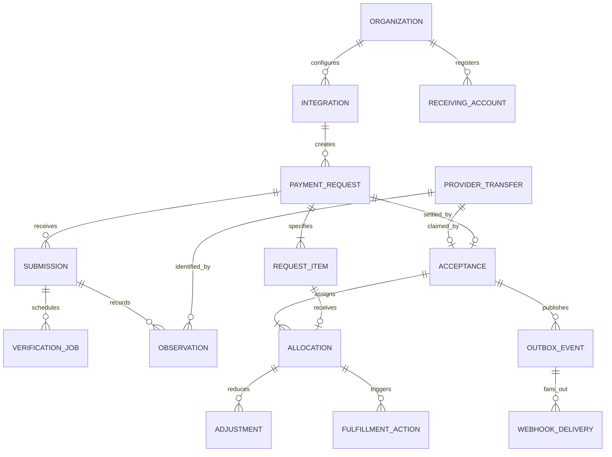

# Transaction Verify database model

The first migration targets PostgreSQL 17. Use separate databases for Myseed Verify, the independent commercial service, and sandbox traffic. The commercial database holds paid and invited partner organizations. The Myseed database holds academy accounts, staff, integrations, and evidence.



## Money, identity, and outcomes

| Record | What it represents |
|---|---|
| Payment request and items | The integrating app's reference and one or more purposes. A request can target a specific approved receiving account. Item types cover subscriptions, donations, campaigns, course fees, sponsorships, bills, orders, and other purposes. |
| Submission and batch | One piece of submitted evidence with its request, status, safe failure details, retry schedule, and operator where applicable. A batch groups submissions without sharing their outcomes. The evidence storage key resolves to an immutable input bundle containing the upload or submitted reference, QR content, or link. |
| Provider transfer | A canonical identity derived from the provider record, scoped to the organization, provider, and the provider's reference namespace. Connectors for equivalent receipt channels must map to the same identity. A receipt image or raw QR text does not define the identity. |
| Verification observation | One lookup result with the evidence source, amount, currency, recipient match, provider timestamp, and receipt comparison. Multiple attempts can reference the same transfer. |
| Acceptance and allocations | The successful claim of a transfer by one request. Allocations record which parts paid for which purposes. The same request and the same transfer each have at most one acceptance per organization. |
| Adjustment | A record of a refund or reversal against a specific allocation. The acceptance and original consumption timestamp remain available for duplicate checks. |
| Outbox event and webhook delivery | A stable event saved with acceptance and delivery state for each endpoint on the originating integration. Delivery success and downstream fulfillment are tracked separately. |

Store exact amounts as integer minor units. For ETB, `125000` represents 1,250.00 ETB. Fixed items must add up to the confirmed amount. A single open-amount item uses the provider-confirmed amount. An installment can have its own request. For example, a 1,250 ETB transfer can be assigned to a 1,000 ETB course fee and a 250 ETB donation on the same request. A transfer used on that request cannot be used on a second request. The integration owns the student balance, campaign totals, order, or subscription lifecycle and uses its item references to apply the allocations.

`accept_payment` takes an observation from the trusted verification service. It checks the recipient, amount, currency, receipt consistency, applicable payment date, and request state. It writes the acceptance, allocations, submission result, and `payment.accepted` event in a single database transaction. A repeat for the same request returns its existing acceptance. A competing request gets `already_used` with the original acceptance timestamp and no original payment ID. An observation with insufficient recipient evidence needs review. A reviewer can record a decision and use confirmed evidence from authorized account records.

`expires_at` is the submission cutoff. An admitted job can complete after that time. `not_before` is the earliest permitted provider payment timestamp. Cancellation blocks pending acceptance. Request items and reference rules are finalized before a submission token is issued.

## Processing and integration boundaries

1. The backend SDK creates a request and uses an expiring submission token scoped to that request. The API uses the request's integration and organization from authenticated context. The client submits an upload, QR, link, or reference. Store the evidence bundle, then create the submission and first job together. Repeated idempotency keys return the existing submission if the fingerprint matches. A different fingerprint with the same key is an API conflict.
2. Extraction reads a QR, a trusted receipt reference, or a PDF text layer when available. Queue self-hosted OCR for images that need it. Save distinct evidence and statuses for every item in a batch. Provider connectors own reference normalization, namespace rules, account matching, and parsing. Record provider and receipt findings separately.
3. The scheduler rotates among eligible organizations and calls `lease_verification_job`. The function claims one ready job or reclaims an expired lease. It enforces the connector's concurrent lease ceiling across organizations in that database. Commit each lease promptly. A worker must lock the job and verify its lease token and deadline before recording results or calling acceptance. If ownership is lost, discard the stale result. The service sets network timeouts below lease duration, bounds retries, and routes exhausted work to review.
4. The API reserves applicable rate limit buckets with `reserve_rate_limit` in one short transaction and consistent scope order. If one denies the request, roll back the reservations. Use separate burst and sustained buckets where needed. A timed denial maps to HTTP 429 with `Retry-After`. A single request that exceeds the full bucket limit needs a smaller batch. The provider request limit is reserved immediately before lookup and is separate from the lease ceiling. Use application checks for file size, dimensions, and batch size.
5. The API maps reason codes to localized messages, actions, and retry guidance. For example, `receipt_mismatch` prompts for the original receipt, `already_used` shows the previous use time within authorized scope, and `provider_unavailable` stays pending with a scheduled retry. Persist the next retry time and job schedule together. Extraction errors are recorded by workers on the submission and job.
6. A dispatcher creates delivery rows for eligible endpoints and marks the event dispatched in one transaction. The webhook envelope carries the stable outbox event ID. The receiver validates the signature and deduplicates by event ID before applying business changes. Integrations report results such as subscription activation, receipt generation, or acknowledgment delivery independently in fulfillment actions.

Provider checks, queue scheduling, SDK tokens, webhook signing and delivery, and application authorization are service responsibilities. The migration contains no live provider configuration. Configure connector limits only after validating the access method and canonical reference rules. Each runtime needs a database role with explicitly scoped grants, and every API query must apply authenticated organization and integration scope. Composite foreign keys constrain relationships between organizations and integrations. Direct database access is reserved for trusted services. Use private evidence storage, protected signing secret references, and key digests for API credentials.

For adjustments, the reconciliation service must lock the allocation before inserting an adjustment, enforce the remaining refundable balance, and write its event in the same transaction. It should use a canonical adjustment reference for deduplication. Partner authorization must check the active approval grant and usage limits. Commercial billing and its pricing rules belong to the service consuming the organization access model.

## Apply and verify

Apply once per empty database. The verification script uses synthetic receipts and rolls back its fixtures.

```sh
psql -X -v ON_ERROR_STOP=1 -d transaction_verify -f database/001_initial.sql
psql -X -v ON_ERROR_STOP=1 -d transaction_verify -f database/verify_model.sql
```

PostgreSQL row locks serialize attempts on the same request, the unique transfer claim resolves competing requests, and the queue uses row locking to distribute work. [PostgreSQL locking](https://www.postgresql.org/docs/17/explicit-locking.html) · [PostgreSQL queue locking](https://www.postgresql.org/docs/current/sql-select.html)
