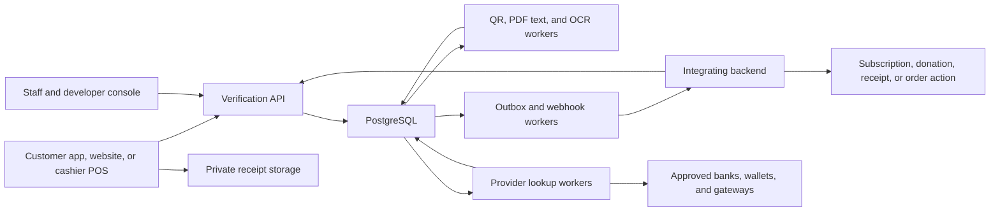

# System and repository architecture

## Deployment boundaries

Use one modular TypeScript codebase for the verification engine, with separate deployments for Myseed, the commercial service, and developer sandbox traffic. Myseed and the commercial operator each control their own database, private receipt storage, identity configuration, API keys, signing keys, domains, and deployment credentials. Production receipt records and logs stay within their deployment. Sandbox uses synthetic provider responses and accepts test credentials only. Myseed users can submit evidence through the academy's own website or app while the staff console remains private.

Start with Node.js and TypeScript, Fastify for the HTTP API, React for the console, PostgreSQL 17 for durable state and job leases, and private S3-compatible object storage. Run the API and workers as independently scalable processes from the same repository. Keep the current SQL migrations as the schema source of truth and use explicit transactions for operations spanning several tables. The SDK contract is portable to other stacks. Framework and hosting choices are design defaults.



## Proposed repository

```text
transaction-verify/
  apps/
    api/                     HTTP routes, authentication, request validation
    worker/                  Extract, OCR, lookup, outbox, and maintenance processes
    console/                 Shared UI with deployment-specific navigation and capabilities
    cashier/                 Cashier PWA: bill lookup, QR scan, result
    hosted/                  Hosted submission page
  packages/
    domain/                  Verification rules, state transitions, money and reason codes
    contracts/               Types generated from the OpenAPI contract
    messages/                English and Amharic texts for reason codes and states
    persistence/             Scoped queries and transaction boundaries
    provider-connectors/     One module and fixture suite per approved provider channel
    evidence/                File validation, parsing, QR, PDF text, and OCR adapter
    sdk-server/              Node client, authentication, and webhook verification
    sdk-web/                 Browser submission and status client
    sdk-mobile/              React Native capture and upload adapter
    ui/                      Shared accessible form controls and status components
  contracts/                 Versioned OpenAPI and event contracts
  database/                  Numbered SQL migrations and database checks
  examples/                  Web, mobile, cashier, and webhook consumer demos
  tests/                     End-to-end and load fixtures with synthetic data
  ops/                       Local environment, CI, deployment and recovery runbooks
  docs/                      Design, decisions, provider register, and user guides
```

Apps assemble the modules. Domain logic depends on types and interfaces, and the worker injects provider and storage implementations. The API, workers, and console share the same reason codes. SDKs depend on public contracts and have no dependency on internal persistence or provider code. Integrating services consume API events through their own repositories.

## Request and worker lifecycle

1. The integrating backend creates a payment request with an immutable purpose, recipient policy, currency, and expected amount rules. It grants the client short-lived access to submit evidence and read status for that request.
2. The API validates admission limits and reserves a scoped upload when needed. The client uploads directly to private storage. The API verifies that the completed object belongs to the session and records the submission and first job in one transaction. A cleanup job removes unused upload reservations and orphaned objects.
3. A worker reads a QR, provider link, or PDF text layer first. An image-only receipt goes to a bounded self-hosted OCR pool. If a provider record exists and the user also uploads an image, compare readable evidence with provider data when the policy calls for it. Low confidence prompts correction or review. Extraction identifies fields, while the provider record supplies confirmation.
4. A lookup worker validates the connector and spends its provider request budget immediately before the call. It records an observation, evaluates the payment, and verifies the job's lease token before committing any result. A timed-out worker's stale result is discarded. For an eligible payment the existing acceptance routine atomically records the claim, allocations, and event.
5. The outbox dispatcher creates delivery records for eligible endpoints. The receiver verifies the signature and records the event and business action idempotently. Payment acceptance, webhook delivery, and downstream fulfillment each have their own state and can recover independently.

## Handling load and failure

| Concern | Design |
|---|---|
| Simultaneous scans | Multiple workers lease jobs independently. Deduplicate the canonical provider transfer across an organization's branches and integrations with the database constraint. The same request can retrieve its accepted result. |
| Bulk traffic | Give each receipt its own job. Rotate organizations, cap active jobs per organization, and use weighted scheduling between interactive and batch traffic so both progress. Expose partial batch results and allow individual correction. |
| Provider bottlenecks | Set a concurrency ceiling, rate budget, timeout, and bounded retry schedule for each provider credential or quota group. Pause repeated calls during an outage and probe for recovery. If deployments share an upstream quota, partition the budgets or coordinate them explicitly. |
| Self-hosted OCR | Bound image pixels, PDF pages, memory, and processing time. Scale the OCR pool separately and benchmark on authorized receipt fixtures. QR and link extraction save compute where sufficient. |
| Retry safety | Check previously recorded idempotent operations before spending new-write quota. Keep idempotency lookup behind authentication and normal read limits. Lock or fence leased work before writing results. |
| Degraded service | Admit only work that can be durably stored. Return a retryable overload response when capacity is exhausted. Accepted submissions remain trackable through restarts and provider outages. |

Use database leases under the tested Read Committed transaction model. Keep transactions short and perform network calls outside them. Starting capacity depends on measured arrival rates, OCR share, OCR processing time, and authorized provider throughput. Track queue wait and processing duration separately. Add infrastructure when measurements identify a bottleneck.

## Trust and operations

- Use trusted backend credentials, short-lived scoped submission tokens, and staff sign-in through an identity provider. Apply organization, integration, and role filters on reads and writes. Bind provider evidence and credentials to the intended environment. Use least-privilege database roles and test read isolation separately from foreign key isolation.
- Keep full receipt evidence in encrypted, private storage. Treat every upload, QR, URL, PDF, and webhook destination as untrusted. Inspect files with bounded resources. Use explicit egress rules for provider lookups and webhooks, including redirect and private address protections. Prevent a user-supplied URL from turning the worker into a general HTTP proxy.
- Show previous acceptance details only to authorized staff in the relevant organization. Public status views can show safe feedback without exposing another payer, bill, or account. Audit receiving-account changes, reviewer decisions, partner approvals, and key rotation. Require separate approval for high-risk receiving-account changes.
- Track request IDs, queue age, provider failures, OCR rate, duplicate conflicts, webhook delivery age, and fulfillment backlog. Redact receipts, account identifiers, and secrets from logs. Define evidence retention, deletion, backup recovery, and restore verification before live pilots.
- Deploy with an automated migration check, separate environment secrets, readiness checks, worker shutdown that preserves leases, and alerts for growing backlogs. Use forward-compatible migrations across rolling deployments.

## Changes to design before implementing services

The existing database covers claims, allocations, observations, job leases, rate windows, and acceptance events. Add the following in numbered migrations as the corresponding features are implemented.

| Gap | Required decision or change |
|---|---|
| Intake and replay | Add upload reservations with owner, object key, checksum, size, expiry, and finalization state. Use a scoped idempotency record for create-request and upload operations. The existing submission key supports evidence retries. |
| Receiving account changes | Add a pending-change and approval history with proof references. Freeze an approved recipient set per request when a specific receiving account is required. |
| Observations and review | Record per-check results, source capability, evidence versions, and provider credential references. Review decisions must reference the evidence being reviewed. Provider and receipt conflict rules can route unresolved cases to review. |
| Public status | Expose a stable, redacted status projection. Use decimal strings for minor units at the API boundary, including events. The initial SQL outbox uses numeric amounts internally, so the dispatcher must serialize from exact values without passing them through JavaScript floating-point numbers. |
| Delivery and fulfillment | Add event delivery attempt history, payload contract version, signing key rotation metadata, and a revision counter per fulfillment action to make reporting idempotent. Record worker attempts where the latest reason and count are insufficient. |
| Adjustments | Enforce the remaining refundable amount with a transactional adjustment write and emit a corresponding event. Derive outstanding balances from original allocations and adjustments. |
| Commercial billing | Add entitlements, a usage ledger, invoices, checkout attempts, and gateway event deduplication. Keep billing records distinct from the customer's verified payments. |

Live provider validation, legal receipt requirements, and production performance thresholds are release gates. The existing SQL migration stays the baseline for the service build.
