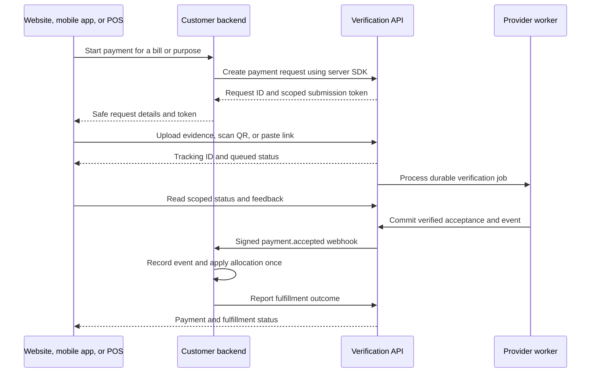

# Integrations and SDKs

The first release includes a versioned HTTP API, a Node server SDK, a browser SDK, a React Native mobile adapter, and signed webhooks. Web and mobile integrations share the same payment and status contract. React Native is the initial mobile target. Other stacks can use the documented HTTP API.

## Integration sequence

## HTTP surface

The draft OpenAPI contract (`contracts/openapi.v1.json`) covers the first SDK journey. Additional administrative and operational routes will have their own contract additions.

| Operation | Caller | Behavior |
|---|---|---|
| `POST /v1/payment-requests` | Server SDK | Create a request and initial scoped token. Stable external reference and idempotency key prevent repeated creation. |
| `POST /v1/payment-requests/{requestId}/submission-token` | Server SDK | Renew scoped access after rechecking ownership. Token refresh never extends the payment deadline. |
| `POST /v1/payment-requests/{requestId}/uploads` | Client SDK | Reserve a private upload URL for one object with allowed metadata and size. |
| `POST /v1/payment-requests/{requestId}/submissions` | Client SDK | Admit a receipt upload, QR, link, or reference. Acknowledge the job with HTTP 202 and return its tracking ID. |
| `GET /v1/payment-requests/{requestId}` | Scoped client or server SDK | Return request status and latest relevant submission and fulfillment states. |
| `GET /v1/payment-requests/{requestId}/submissions/{submissionId}` | Scoped client or server SDK | Return a specific submission's status, reason, and guidance. |
| `PUT /v1/payment-requests/{requestId}/allocations/{allocationId}/fulfillment/{action}` | Server SDK | Record an idempotent action status such as receipt issued or subscription active. |
| `GET /v1/organization/settings`, `PUT /v1/organization/settings` | Server SDK | Read and replace the organization's settings: token lifetime, default deadline or open requests, provider retries, evidence retention, calendar, staff sign-in, billing mode, channel rule. A `null` field uses the deployment default; the response also returns the values in force. |
| `GET /v1/channels`, `PUT /v1/channels/{providerId}` | Server SDK | The catalog of Ethiopian banks, wallets and gateways with certification state and whether each can be verified now, and the organization's choice of accepted channels. Evidence from other channels is refused with `channel_not_accepted`. |
| `POST /v1/batches`, `GET /v1/batches/{batchId}` | Server SDK | Admit up to 100 payments with their evidence (a link, QR text or reference) in one call, six calls a minute per key. Each item is a payment request with one submission, checked and announced by webhook like any payment. Items that cannot be admitted carry their error and the rest go ahead. Repeating the call with the same Idempotency-Key resumes a batch that was cut off. Batch work runs after the organization's single payments. |

`POST /v1/payment-requests` and batch items accept an optional `payer` with `email` and `phone`. When the organization has payer messages turned on, the payer gets one email or SMS when the payment is accepted, rejected or sent to review. An address or number that is not valid is refused with `invalid_payer_contact`. Ethiopian mobile numbers may be written 09..., 07..., 9... or +251....

Request amounts and event amounts use decimal strings in minor units to preserve integer precision. A null item amount means one open-amount item on that request. Paths are scoped to the authenticated integration and request. The SDK preserves a stable idempotency key across transport retries. A changed payload under the same key returns HTTP 409. Terminal verification outcomes are status resources. HTTP errors describe invalid or unadmitted calls, including 429 with `Retry-After` for timed throttling. Poll with bounded backoff and stop when a submission reaches a terminal result or enters review.

Fulfillment reports include a monotonically increasing revision per allocation and action. Replaying a revision with identical values returns the existing result. Reusing a revision with changed values or sending a stale revision returns HTTP 409. The allocation ID exposed by v1 is its payment request item UUID, matching the existing database relationship.

## SDK build and release

| Package | Build responsibilities | Verification before release |
|---|---|---|
| Server SDK, `@myseed-verify/server` | A typed client: request creation, token renewal, status calls, batches, fulfillment reports, and webhook verification using raw request bytes. | Signature fixtures, transport retries and conflict tests, and the quickstart test |
| Browser SDK, `@myseed-verify/web` | A small typed client for upload reservations, uploads, evidence submission and polling. `mountPayment` is the drop-in component: it shows what is owed, takes a link, QR text, a file, or a camera QR scan, and follows the result, inside a shadow root. | Unit tests; a real browser and keyboard-only pass before each release |
| Myseed sub-SDK, `@myseed-verify/academy` | The server SDK with the Myseed Verify address (`https://transactionverify.myseed.com.et`), builders for subscriptions, course fees and installments, and donations, and `parseTarget` for webhook handlers. | Same as the server SDK, plus builder round trips |
| React Native adapter, `@myseed-verify/react-native` | Reuses the browser client with an app-supplied SHA-256 and random ID. Picked receipts (gallery, camera, documents), scanned codes, `PendingChecks` to resume a check after the app was closed, and permission texts. | Unit tests; Android and iOS device tests for interruptions, permission denial, large receipts, and expired tokens before each release |

Use one workspace lockfile and per-package build commands. The contract produces TypeScript definitions. Build runtime wrappers with declarations, test imports from packed packages, check browser and mobile bundles for server-only dependencies, and publish versioned packages with release notes after sandbox integration passes. Packages are published on npm under the `@myseed-verify` scope (decision log, items 14 and 22); internal workspace packages stay private as `@transaction-verify/*` and are bundled into the published SDKs at release. Provide runnable quickstarts for plain HTTP, Node, browser embed, and mobile, plus a webhook receiver example.

**Publishing.** The SDKs are self-contained: `scripts/sync-sdk-contract.mjs` copies the contract types into each one, and `npm run sdk:check` confirms that each package has no private dependency and contains only built files, the README and the license. Pushing a tag such as `sdk-v0.5.0` runs `.github/workflows/publish-sdks.yml`, which publishes the three packages with provenance. It needs an `NPM_TOKEN` secret for the account that owns the `@myseed-verify` scope. Versions and deprecations follow [API versions and deprecation rules](api-versioning.md). New developers start with the [quickstart](quickstart.md).

## Webhook events

| Event | When | What the app does |
|---|---|---|
| `payment.accepted` | A payment is verified and accepted, automatically or by a reviewer | Apply each allocation once: activate the subscription, mark the installment paid, issue the receipt |
| `payment.adjusted` | Staff record a refund or reversal against an allocation | Reduce or undo the business effect once; `remainingMinor` says what is left of the allocation |

Both carry a stable event ID and are signed the same way. `verifyWebhook` returns either type; switch on `event.type`.

**Test and live.** Each event says `"environment": "test"` or `"live"`. Each endpoint chooses which events it receives: **Test only**, **Live only**, or **Test and live** (the default, which matches how endpoints behaved before November 2026). A receiver that takes both must check `event.environment` before it changes real data. **Send a test payment** on the Developers page pays a sandbox request, so a test webhook arrives without writing code. From code, a reference such as `SYN-P1500X7K` pays a test request: `SYN-P`, the amount in birr, `X`, and any short code. Each code is a new transfer.

## Webhook delivery and receiver behavior

Every event has an ID, schema version, type, occurrence time, and payload. Sign the exact raw body with HMAC SHA-256 using an endpoint secret and the delivery timestamp. The signature input is the timestamp in Unix seconds, a dot, and the raw body bytes. Include a key identifier for rotation. The receiver checks the signature with constant-time comparison and a bounded timestamp window before parsing the event. Redelivery keeps the same event ID and uses a fresh delivery timestamp and signature.

The headers are `X-Verify-Timestamp`, `X-Verify-Key-Id`, and `X-Verify-Signature`. Encode the signature as lowercase hexadecimal. Start sandbox testing with a five-minute clock tolerance and adjust it only with a documented interoperability reason.

The receiver persists the event ID and its business update, or a durable local job, before responding with success. Retrying can deliver a webhook more than once. If events arrive out of order, reconcile with the authoritative resource and apply explicit state transitions. The first contract includes `payment.accepted`. Add adjustment events and any other status notifications in versioned contract revisions. Credentials, full account numbers, and receipt images stay out of event payloads.

## Integration examples

- **Myseed subscriptions and fees.** The academy backend creates a request tied to a subscription period or installment. The webhook activates the entitlement or posts the installment and generates the academy receipt.
- **Donations, fundraisers, and sponsorships.** The academy backend attaches the donor or campaign reference. On acceptance it records the received amount, updates confirmed campaign totals, and issues the acknowledgment with the chosen privacy settings.
- **Restaurant POS.** The POS creates a request for a bill, scans a QR, and receives the reason for any failed or pending check. Authorized staff can see the original use time of a previously accepted transfer.
- **Commercial website or mobile app.** The merchant backend creates the request and owns fulfillment. Client SDKs handle evidence and status. Private free partners use the same contract with an approved entitlement and enforced limits.
